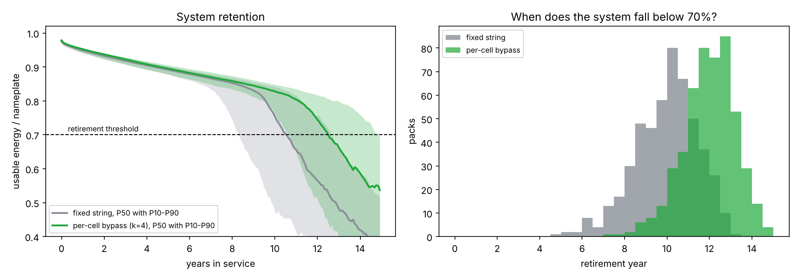

# Beyond the Weakest Cell: REON cell-level control value model

MIT Energy & Climate Hack 2026, REON challenge. This repo estimates what per-cell bypass is worth compared with a conventional fixed series string. It combines

1. a **learned fault model**: each cell's hard-fault process is a **non-homogeneous Poisson process (NHPP)** whose intensity is predicted from telemetry REON already measures, and
2. a **Monte Carlo aging simulator**: gradual capacity drift with knee onset, plus those faults, for both architectures on identical cells.

```bash
pip install -r requirements.txt
python -m pytest -q             # 24 tests, including the Poisson-reduction checks
python scripts/run_demo.py      # writes outputs/summary.md and figures
```

> **Every number is an estimate under placeholder assumptions.** Nothing here is a REON performance claim. Parameter defaults live in `reon_model/simulate.py` (`PackConfig`, `AgingConfig`, `HazardConfig`). They need to be calibrated on real data: the Zhou et al. 2026 fleet data, the TUM Na-ion aging data, and REON's own inputs (switch loss, voltage window).

## 1. Fault model: NHPP with a learned intensity

Cell *i* has intensity

$$\lambda_i(t) = \lambda_0 \exp\big(\beta^\top x_i(t)\big)$$

The features $x_i(t)$ come from per-cell monitoring and are measured relative to the cell's own pack:

| feature | meaning |
|---|---|
| `temp_offset_C` | cell temperature minus pack mean (°C) |
| `soh_gap` | pack-mean SOH minus this cell's SOH (positive = weaker than its neighbors) |
| `resistance_gap` | $R_i / \text{median}(R) - 1$ |

The intensity is held constant within each telemetry period (one month). That makes it a piecewise-exponential model, and its likelihood is exactly a Poisson GLM with a log-exposure offset:

$$\ell(\beta) = \sum_{\text{cell-months } r} y_r \log(e_r\lambda_r) - e_r\lambda_r$$

Here $y_r$ is the number of faults in the period and $e_r$ is the time the cell was at risk. A cell that is bypassed or replaced simply stops contributing rows, so right-censoring is handled exactly. The model is fitted by Newton-Raphson (`PoissonIntensityGLM`). A gradient-boosted challenger with Poisson loss is included, and both are scored on held-out packs.

Pack-level quantities follow from $\Lambda_i(t) = \int_0^t \lambda_i$:

- **Fixed string:** it goes down at the first fault in any cell. The faults form a superposed NHPP, so $P(\text{up}) = \exp(-\sum_i \Lambda_i)$.
- **Bypass with headroom *k*:** it stays up while at most *k* cells have faulted. That count is Poisson-binomial with $p_i = 1 - e^{-\Lambda_i}$ (`bypass_survival`). Setting *k* = 0 recovers the fixed string exactly.

### Reduction to the simple Poisson process when all λ are equal

Every routine is written in terms of $\Lambda$ and $\Lambda^{-1}$ (sampling uses the time-rescaling theorem: $t_j = \Lambda^{-1}(E_j)$ with $E_j$ the arrival times of a unit-rate Poisson process). So the homogeneous case is not a separate code path. It falls out of the same code:

| if all λ are equal (= λ) | the code gives | test |
|---|---|---|
| piecewise rates all equal | $\Lambda(t) = \lambda t$, $N(t) \sim \text{Poisson}(\lambda t)$, Exp(λ) gaps, and the same event times draw-for-draw as a homogeneous sampler | `test_equal_pieces_*` |
| N cells with rate λ | superposition is Poisson with rate $N\lambda$, and $P(\text{fixed string up}) = e^{-N\lambda t}$ | `test_superposition_*`, `test_fixed_string_survival_equal_rates` |
| Crow-AMSAA $\Lambda = \lambda t^\beta$ | β = 1 gives a homogeneous process (fitted β ≈ 1 on Poisson data) | `test_power_law_*` |
| log-linear $\lambda = e^{\alpha+\beta t}$ | β = 0 gives rate $e^\alpha$ (and the limit is continuous as β → 0) | `test_log_linear_*` |
| failed-cell count | Poisson-binomial reduces to Binomial(N, 1−e^{−λt}) | `test_poisson_binomial_*` |
| GLM with β = 0 or identical features | MLE is exactly $\hat\lambda = \sum y / \sum e$ | `test_intercept_only_*`, `test_constant_features_*` |
| full simulator, β = 0 | fixed-string fault counts are Poisson($N\lambda T$) with dispersion ≈ 1 | `test_fixed_string_with_equal_rates_gives_poisson_fault_counts` |

`PoissonIntensityGLM.lrt_vs_homogeneous()` runs a likelihood-ratio test of H0: "all λ equal". This lets the data decide whether the NHPP structure is needed at all.

## 2. Capacity drift and usable energy

Each cell fades as

$$Q_i(t) = q_{0,i}\Big[1 - m_i\big(k_\text{cal}\sqrt{t} + k_\text{cyc}\,\text{EFC}(t)\big) - m_i\,k_\text{knee}\,(t-\tau_i)_+^2\Big]$$

where:

- $m_i$ is the cell's aging multiplier: a lognormal manufacturing spread times an Arrhenius factor for its slot temperature.
- $\tau_i$ is the knee onset time, drawn from a Weibull distribution and scaled by $1/m_i$.
- EFC is the number of equivalent full cycles.

Series cells share one current. If the inverter's voltage window allows *h* more cells to drop out during a discharge, the string stops when the (h+1)-th weakest cell empties. The delivered charge is then

$$\sum_i \min\big(Q_i,\ Q_{(h+1)}\big)$$

This gives *N*·min *Q* for the fixed string (h = 0) and Σ*Q* when every cell runs to its own end (h = N−1). It reproduces the brief's 16-cell example (`test_brief_sixteen_cell_example`). Bypass energy is also multiplied by a switch-efficiency loss.

## 3. Demo results (placeholder parameters)

`scripts/run_demo.py` simulates one 96-cell, 59.5 kWh EBS-sized block, with bypass headroom k = 4, cycled once a day, retired below 70% of nameplate, over 500 Monte Carlo packs. The paired difference on identical cells is **+1.75 years of service** (P10 0.3, P90 4.0), **+32 MWh delivered** over the block's life, and **8 → 1** service outages. The full tables are in [`outputs/summary.md`](outputs/summary.md).



## Layout

```
reon_model/nhpp.py             Poisson / NHPP primitives (piecewise, Crow-AMSAA, log-linear, pack survival)
reon_model/intensity_model.py  Poisson-GLM intensity learner, LRT vs homogeneous, GBM challenger
reon_model/simulate.py         aging + fault Monte Carlo, fixed vs bypass, telemetry rows for training
scripts/run_demo.py            end-to-end demo -> outputs/
tests/                         reduction-to-Poisson and model tests
```

## Next steps

- Calibrate the aging spread and knee onset on the Zhou et al. per-cell data and the TUM Na-ion data. Swap the synthetic telemetry rows for real cell-period rows; `PoissonIntensityGLM.fit(X, events, exposure)` takes them directly.
- Add the economics layer: Massachusetts C&I demand charges, ConnectedSolutions payments, and deferred augmentation or replacement. Then a sensitivity tornado.
- Ask REON for the switch loss, the voltage window (realistic *k*), and observed cell fault rates.
