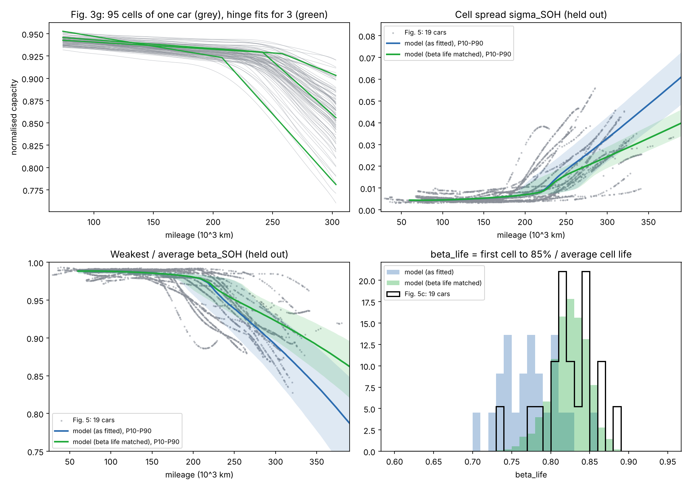
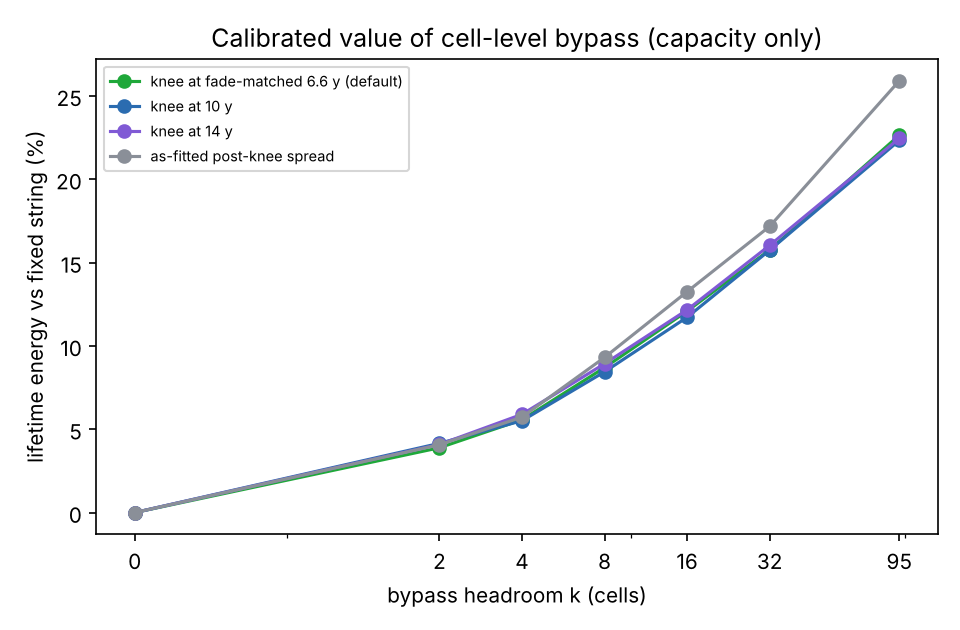

# Beyond the Weakest Cell: REON cell-level control value model

MIT Energy & Climate Hack 2026, REON challenge. Team: Isabell Luo (MIT), Annabelle Wu (Harvard), Miya Cao (Stanford), David Gardner (BU).

**Question.** For a Massachusetts commercial customer with a REON EBS battery (sodium-ion, 30 kW / 60 kWh per block, 250 cells per string with about 10% backup cells), how much more energy, life, reliability, money and CO₂ does per-cell sensing and bypass deliver than the same cells in a conventional series string, where the weakest cell limits everything and one failed cell stops the whole battery?

**Answer (v4, Python reference, 2,000 paired packs; full tables in [`outputs/value_summary.md`](outputs/value_summary.md)):**

| Per two-block site (60 kW / 120 kWh), Eversource G-2 | Result |
|---|---|
| Lifetime energy and service life per battery | **+12.1% energy, +10.6% life** |
| 20-year value gain (replacements at NREL-projected prices, NREL O&M, REON's +4% BMS cost, 50% demand-charge capture) | **+$4.3k** (P10 +$2.0k, P90 +$6.7k) |
| With 0.1% cell failures per year and conventional blocks replaced at their first failure (an assumed scenario, in the range of REON's stated 2–3×; we do not know how REON measured theirs) | **2.3× the energy and life, +$87k** |
| Customers: neighborhood grocer (G-1 demand option) / cold-storage warehouse (G-3, 10 blocks) | +$4.7k / +$20.7k |
| Per 100 MW of C&I storage | +$7.2M, +19 GWh, 9.5 kt CO₂ avoided (if charged from on-site solar), 368 t of cells not made over 20 years |

**Open the dashboard:** https://claude.ai/artifact/2uKjEAMjq2JzoyPa3ejHJd (or download the repo and double-click `webapp/index.html`). How to read it: [`docs/USER_GUIDE.md`](docs/USER_GUIDE.md).

**Where to read more:**
- [`docs/Methodology_v2.md`](docs/Methodology_v2.md): the full method, every assumption with its source, validation, results, sensitivities and limitations.
- [`docs/Reliability_and_Customers_Research.md`](docs/Reliability_and_Customers_Research.md): REON CTO notes, cell failure rates, Massachusetts outage costs and rates, customers.
- [`docs/NE_Cold_and_Market_Estimates.md`](docs/NE_Cold_and_Market_Estimates.md): NE Cold site estimate and model rerun, Massachusetts and US market size (every step shown), solar-charging CO₂ caveat, switch-loss check at the rated current.
- [`docs/MA_Economics_Research.md`](docs/MA_Economics_Research.md): the Massachusetts market, policy and revenue research (42 sources).
- **Dashboard**: [`webapp/index.html`](webapp/index.html) (open in a browser, no build), also published at https://claude.ai/artifact/2uKjEAMjq2JzoyPa3ejHJd. A **Customer view** (value, cycle life, usable capacity, round-trip efficiency, payback, reliability, CO₂, with customer presets) and an **Engineering view** (every assumption as a slider, per-cell rings over time, sweeps).

```bash
pip install -r requirements.txt
./scripts/fetch_paper_data.sh   # optional: paper source data (MIT licence) into data/paper/
python scripts/calibrate.py     # optional: refit data/calibration_zhou2026.json, validation report
python -m pytest -q             # 62 tests (2 need the paper data)
python scripts/run_value.py     # the results above -> outputs/value_summary.md (about 20 minutes)
python scripts/run_demo.py      # v1 fault-model demo (96-cell block) -> outputs/summary.md and figures
node webapp/checks/crosscheck.js   # browser model vs Python headline
node webapp/checks/paper_metrics.js  # fixed string vs the paper's beta_life / beta_energy / beta_power
node webapp/checks/trace_pack.js     # one pack month by month, energy re-derived by hand
```

The sections below document the model's building blocks (fault model, calibrated aging, controller). Section 3 shows the **v1 demo** (96-cell block, 4 backups, placeholder fault hazard); the current results are in the table above and in the methodology.

> **What is calibrated and what is not.** The cell-to-cell aging *spread* (rates, knee onset, post-knee slopes and their correlations) comes from real per-cell data and is checked against held-out fleet metrics. The stationary *timeline* (fade per year, knee onset in years), the NMC-to-sodium-ion transfer, the pack design and every fault-hazard number are assumptions. Nothing here is a REON performance claim.

## 1. Fault model: NHPP with a learned intensity

Cell *i* has intensity

$$\lambda_i(t) = \lambda_0 \exp\big(\beta^\top x_i(t)\big)$$

The features $x_i(t)$ come from per-cell monitoring and are measured relative to the cell's own pack:

| feature | meaning |
|---|---|
| `temp_offset_C` | cell temperature minus pack mean (°C) |
| `soh_gap` | pack-mean SOH minus this cell's SOH (positive = weaker than its neighbors) |
| `resistance_gap` | $R_i / \text{median}(R) - 1$ |

The intensity is held constant within each telemetry period (one month). That makes it a piecewise-exponential model, and its likelihood is exactly a Poisson GLM with a log-exposure offset:

$$\ell(\beta) = \sum_{\text{cell-months } r} y_r \log(e_r\lambda_r) - e_r\lambda_r$$

Here $y_r$ is the number of faults in the period and $e_r$ is the time the cell was at risk. A cell that is bypassed or replaced simply stops contributing rows, so right-censoring is handled exactly. The model is fitted by Newton-Raphson (`PoissonIntensityGLM`). A gradient-boosted challenger with Poisson loss is included, and both are scored on held-out packs.

Pack-level quantities follow from $\Lambda_i(t) = \int_0^t \lambda_i$:

- **Fixed string:** it goes down at the first fault in any cell. The faults form a superposed NHPP, so $P(\text{up}) = \exp(-\sum_i \Lambda_i)$.
- **Bypass with headroom *k*:** it stays up while at most *k* cells have faulted. That count is Poisson-binomial with $p_i = 1 - e^{-\Lambda_i}$ (`bypass_survival`). Setting *k* = 0 recovers the fixed string exactly.

### Reduction to the simple Poisson process when all λ are equal

Every routine is written in terms of $\Lambda$ and $\Lambda^{-1}$ (sampling uses the time-rescaling theorem: $t_j = \Lambda^{-1}(E_j)$ with $E_j$ the arrival times of a unit-rate Poisson process). So the homogeneous case is not a separate code path. It falls out of the same code:

| if all λ are equal (= λ) | the code gives | test |
|---|---|---|
| piecewise rates all equal | $\Lambda(t) = \lambda t$, $N(t) \sim \text{Poisson}(\lambda t)$, Exp(λ) gaps, and the same event times draw-for-draw as a homogeneous sampler | `test_equal_pieces_*` |
| N cells with rate λ | superposition is Poisson with rate $N\lambda$, and $P(\text{fixed string up}) = e^{-N\lambda t}$ | `test_superposition_*`, `test_fixed_string_survival_equal_rates` |
| Crow-AMSAA $\Lambda = \lambda t^\beta$ | β = 1 gives a homogeneous process (fitted β ≈ 1 on Poisson data) | `test_power_law_*` |
| log-linear $\lambda = e^{\alpha+\beta t}$ | β = 0 gives rate $e^\alpha$ (and the limit is continuous as β → 0) | `test_log_linear_*` |
| failed-cell count | Poisson-binomial reduces to Binomial(N, 1−e^{−λt}) | `test_poisson_binomial_*` |
| GLM with β = 0 or identical features | MLE is exactly $\hat\lambda = \sum y / \sum e$ | `test_intercept_only_*`, `test_constant_features_*` |
| full simulator, β = 0 | fixed-string fault counts are Poisson($N\lambda T$) with dispersion ≈ 1 | `test_fixed_string_with_equal_rates_gives_poisson_fault_counts` |

`PoissonIntensityGLM.lrt_vs_homogeneous()` runs a likelihood-ratio test of H0: "all λ equal". This lets the data decide whether the NHPP structure is needed at all.

## 2. Capacity drift (calibrated) and usable energy

Each cell fades as

$$Q_i(a) = q_{0,i} - m_i\,B(a) - \kappa_i\,\bar b\,(a-\tau_i)_+$$

where:

- $B(a) = k_\text{cal}\sqrt{a} + k_\text{cyc}\,\text{EFC}(a)$ is the mean cell's base fade (stationary assumption).
- $m_i$ is the cell's pre-knee rate multiplier.
- $\tau_i = \bar\tau\,P_\text{pack}\,\tau_{\text{rel},i}$ is its knee onset.
- After the knee the cell fades **linearly** at $\kappa_i$ times the mean pre-knee rate $\bar b = B(\bar\tau)/\bar\tau$.
- $(m, \tau_\text{rel}, \kappa)$ are jointly normal across cells. A slot's temperature offset carries the Arrhenius share of $m$.

Series cells share one current. If the inverter's voltage window allows *h* more cells to drop out during a discharge, the string stops when the (h+1)-th weakest cell empties. The delivered charge is

$$\sum_i \min\big(Q_i,\ Q_{(h+1)}\big)$$

This gives *N*·min *Q* for the fixed string (h = 0) and Σ*Q* when every cell runs to its own end (h = N−1). It reproduces the brief's 16-cell example. Bypass energy is also multiplied by a switch-efficiency loss.

### Calibration on Zhou et al. (2026)

Source: [the paper's GitHub repo](https://github.com/Rico-dicp/Ev-battery-cell-to-cell-inconsistency), `Source Data of Figures in Manuscript`. The cells are NMC, from passenger cars with 95 cells in series, and their capacities are estimated from field signals. The full report is in [`outputs/calibration_report.md`](outputs/calibration_report.md).

| from | what | result |
|---|---|---|
| Fig. 3g/3h, one car, 95 cell trajectories | a hinge fit per cell, $Q = a - e(x-x_0) - s(x-\tau)_+$ (median RMSE 0.0007) | pre-knee rate CV 0.38; knee at 240k km ± 4.4% within the pack; post-knee slope 8.4× the pre-knee rate (CV 0.35, roughly symmetric); cells that knee early fade faster after it (r = −0.6); BOL capacity CV 0.0047; resistance +7.5× fractional fade |
| Fig. 4, 12 cars × 95 cells at 80k and 280k km | each car's knee onset from its mean fade | between-pack knee spread: log-sd 0.14 (median 234k km) |
| Fig. 5c, βlife of 19 cars | one shrink factor on post-knee slope spread (0.54), because linear extrapolation over-spreads beyond ~300k km | model βlife 0.82 = data 0.82 |
| Fig. 5a/b, σSOH and βSOH vs mileage for 19 cars | **held out** | matches to within ~10–20% through 300k km |



Two changes the data forced, compared with the earlier placeholders:

1. Post-knee fade is linear (the rate jumps about 10× and then holds), not quadratic.
2. The marginals are close to normal. Lognormal marginals put too many very weak cells in the pack.

**Limitation:** real cars differ from each other more than the model does, because every car is assumed to share one pre-knee rate.

## 3. v1 demo results (96-cell block, k = 4; superseded by the table at the top)

The demo simulates one 96-cell, 59.5 kWh EBS-sized block cycled once a day and retired below 70% of nameplate.

**Capacity alone, with faults turned off.** The gain from bypass depends almost entirely on the headroom *k* and hardly at all on when the knee happens:

| bypass headroom k | 2 | 4 | 8 | 16 | 32 | 95 (every cell to its own end) |
|---|---|---|---|---|---|---|
| lifetime energy vs fixed string | +4% | +6% | +9% | +12–13% | +16–18% | +23–25% |
| service life vs fixed string | +3–4% | +5% | +7–8% | +10% | +13–14% | +19–20% |

The k = 95 bound agrees with the paper: weakest-to-average life ratio βlife ≈ 0.82, i.e. about +21% if every cell ran to its own end. Within a pack the cells knee almost together, so the few weakest cells are only slightly worse than the next ones. Bypassing 4 cells therefore recovers only about a quarter of that bound. **Most of the capacity value needs a wide voltage window (large k).**

**Faults (placeholder hazard).** With k = 4, service outages over the block's life fall from a median of 5 to 0, and availability rises from 98.7% to 100.0%. This ride-through effect is where small-*k* bypass pays off, but it rests on fault rates that the paper data cannot calibrate.



## 4. The brief's given capabilities, as adjustable inputs

The brief says teams may assume (1) individual-cell monitoring of voltage, temperature, SOC, SOH, capacity, resistance, open-circuit voltage and performance history, and (2) switching and selective bypass, chosen by us, subject to system limits. Both are parameters here:

| brief capability | where | what you can change |
|---|---|---|
| per-cell monitoring | `MonitoringConfig` (`reon_model/monitoring.py`) | each signal on/off and its measurement noise; `MonitoringConfig.only("voltage", "temperature")` gives a conventional-BMS view; `.perfect()` gives noise-free readings |
| switching and bypass | `ControlPolicy` (`reon_model/control.py`) | bypass on empty, bypass on fault, isolate when a measured feature or the learned fault risk crosses a threshold, rest the weakest cells each month, spare slots kept for faults |
| system limit | `PackConfig.bypass_headroom` | k = cells the voltage window lets out of the string at once |

The controller and the learned model see only measured signals. Aging and the true fault hazard run on the true cell state. Cycle aging follows each cell's own charge throughput, so bypassing or resting a cell has a real cost and benefit. With every cell fully used it reduces exactly to the calibrated closed form (tested). `ControlPolicy.conventional()` on bypass hardware reproduces the fixed string exactly (tested).

## Layout

```
reon_model/nhpp.py             Poisson / NHPP primitives (piecewise, Crow-AMSAA, log-linear, pack survival)
reon_model/intensity_model.py  Poisson-GLM intensity learner, LRT vs homogeneous, GBM challenger
reon_model/simulate.py         aging + fault Monte Carlo, fixed vs bypass, telemetry rows for training
reon_model/monitoring.py       adjustable per-cell signals and noise
reon_model/control.py          adjustable bypass / isolate / rest policy
reon_model/calibration.py      hinge fits, knee spread, validation against Zhou et al. (2026)
data/calibration_zhou2026.json fitted aging parameters (committed; raw paper data is not)
scripts/fetch_paper_data.sh    download the paper source data
scripts/calibrate.py           refit + validation report -> outputs/calibration_report.md
scripts/run_demo.py            end-to-end demo -> outputs/
webapp/index.html              interactive explorer (JS port of the model, runs in the browser)
tests/                         reduction-to-Poisson and model tests
```

## Next steps

- Ask REON for the per-cell switch on-resistance (the main technical risk: 1 mΩ turns the 20-year gain negative), how the 10% backup cells count toward the 60 kWh rating, field cell-failure rates, and its cell vendor's capacity tolerance.
- Replace the assumed demand-charge capture and peak duration with an NREL ComStock load profile for a grocery and a cold store.
- Price looser-binned and second-life cells, to turn the cell-grade result into a dollar figure.
