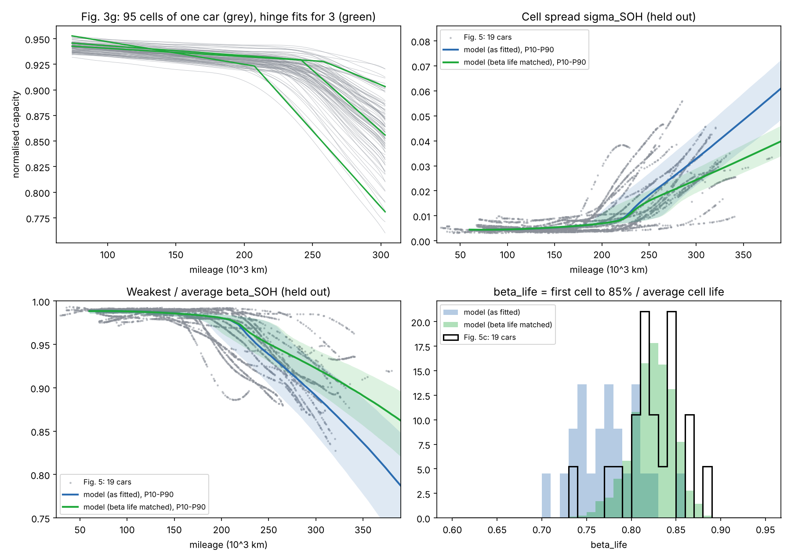

# Aging calibration on Zhou et al. (2026)

Data: `Source Data of Figures in Manuscript` from the paper's GitHub repo (MIT licence). NMC passenger-car cells, 95 in series; capacities are estimated from field signals.

## Fitted from Fig. 3g/3h (one car, 95 cell trajectories, 74k-303k km)

Hinge fit per cell, Q = a - e(x - x0) - s(x - tau)+, median RMSE 0.00074.

| parameter | value |
|---|---|
| pre-knee fade rate e, mean | 0.0106 per 100k km |
| knee onset tau, mean | 240k km |
| post-knee extra slope s, mean | 0.0891 per 100k km (= 8.38 x e) |
| cell-to-cell CV of e / tau / s | 0.379 / 0.044 / 0.347 |
| skew of e / tau / s | 0.51 / -0.78 / -0.09 |
| corr(e, tau), corr(e, s), corr(tau, s) | -0.47, 0.45, -0.60 |
| BOL capacity CV | 0.0047 |
| resistance CV / growth (R/R0 - 1 per unit fade) | 0.059 / 7.48 |
| mean-cell fade at knee onset (vs nominal) | 0.075 |

## Fitted from Fig. 4 (12 cars, 95 cells, 80k and 280k km)

Knee onset per car from its mean fade (assuming the Fig. 3 car's rates): 247, 183, 200, 239, 242, 253, 197, 263, 250, 202, 270+, 264k km (+ = censored). Log-normal MLE: median 234k km, between-pack log-sd 0.139.

## Post-knee spread

Extrapolating each cell's post-knee line indefinitely over-spreads the pack beyond ~300k km (the fleet's sigma_SOH levels off). One parameter, `kappa_spread_scale` = 0.537, shrinks the cell-to-cell spread of post-knee slopes so the model's mean beta_life matches Fig. 5c. Both variants are kept: `as_fitted` (scale 1) and `beta_life_matched` (default).

## Validation

### beta life matched

| check | data | model |
|---|---|---|
| Fig. 4 @280k km sigma_soh (median) | 0.0227 (range 0.0059-0.0524) | 0.0210 (P10-P90 0.0147-0.0254) |
| Fig. 4 @280k km beta_soh (median) | 0.9175 (range 0.8625-0.9796) | 0.9340 (P10-P90 0.9104-0.9551) |
| Fig. 4 @280k km z_min (median) | 3.0501 (range 1.8526-3.9226) | 2.7690 (P10-P90 2.2952-3.5364) |
| Fig. 5 sigma_soh 50-100k (held out) | 0.0050 | 0.0045 |
| Fig. 5 sigma_soh 100-150k (held out) | 0.0049 | 0.0049 |
| Fig. 5 sigma_soh 150-200k (held out) | 0.0065 | 0.0062 |
| Fig. 5 sigma_soh 200-250k (held out) | 0.0139 | 0.0108 |
| Fig. 5 sigma_soh 250-300k (held out) | 0.0239 | 0.0195 |
| Fig. 5 sigma_soh 300-350k (held out) | 0.0270 | 0.0284 |
| Fig. 5 beta_soh 50-100k (held out) | 0.9865 | 0.9881 |
| Fig. 5 beta_soh 100-150k (held out) | 0.9874 | 0.9869 |
| Fig. 5 beta_soh 150-200k (held out) | 0.9784 | 0.9827 |
| Fig. 5 beta_soh 200-250k (held out) | 0.9539 | 0.9659 |
| Fig. 5 beta_soh 250-300k (held out) | 0.9206 | 0.9368 |
| Fig. 5 beta_soh 300-350k (held out) | 0.9105 | 0.9058 |
| Fig. 5c beta_life mean (fitted target) | 0.823 (sd 0.033) | 0.824 (sd 0.024) |

### as fitted

| check | data | model |
|---|---|---|
| Fig. 4 @280k km sigma_soh (median) | 0.0227 (range 0.0059-0.0524) | 0.0269 (P10-P90 0.0159-0.0365) |
| Fig. 4 @280k km beta_soh (median) | 0.9175 (range 0.8625-0.9796) | 0.9107 (P10-P90 0.8709-0.9474) |
| Fig. 4 @280k km z_min (median) | 3.0501 (range 1.8526-3.9226) | 2.9162 (P10-P90 2.3604-3.7570) |
| Fig. 5 sigma_soh 50-100k (held out) | 0.0050 | 0.0045 |
| Fig. 5 sigma_soh 100-150k (held out) | 0.0049 | 0.0049 |
| Fig. 5 sigma_soh 150-200k (held out) | 0.0065 | 0.0063 |
| Fig. 5 sigma_soh 200-250k (held out) | 0.0139 | 0.0121 |
| Fig. 5 sigma_soh 250-300k (held out) | 0.0239 | 0.0249 |
| Fig. 5 sigma_soh 300-350k (held out) | 0.0270 | 0.0400 |
| Fig. 5 beta_soh 50-100k (held out) | 0.9865 | 0.9881 |
| Fig. 5 beta_soh 100-150k (held out) | 0.9874 | 0.9869 |
| Fig. 5 beta_soh 150-200k (held out) | 0.9784 | 0.9822 |
| Fig. 5 beta_soh 200-250k (held out) | 0.9539 | 0.9596 |
| Fig. 5 beta_soh 250-300k (held out) | 0.9206 | 0.9152 |
| Fig. 5 beta_soh 300-350k (held out) | 0.9105 | 0.8628 |
| Fig. 5c beta_life mean (held out) | 0.823 (sd 0.033) | 0.774 (sd 0.035) |

## Not calibrated by this data

- Stationary timeline: `k_cal`, `k_cyc` and the knee onset in years. The default transfers the knee by matching the mean cell's fade at onset (0.075); `run_demo.py` reports sensitivity to it.
- Chemistry: these are NMC EV cells, and REON's EBS is sodium-ion. The spread structure is assumed to transfer.
- Fault hazards: the repo has no fault events, so `HazardConfig` stays a placeholder.
- Between-car differences in pre-knee rate are folded into the knee-onset spread.